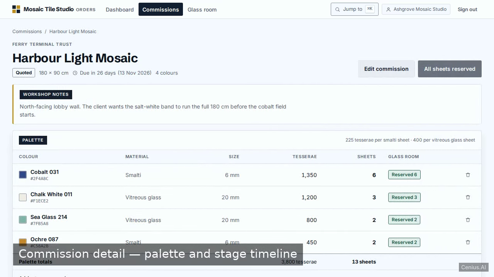
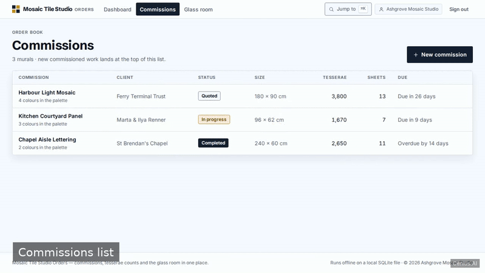
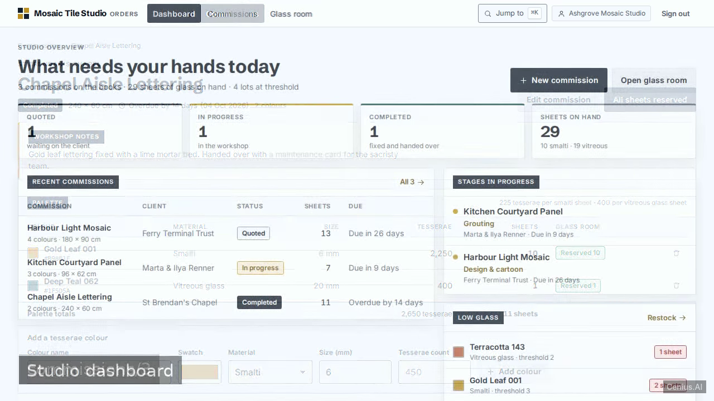
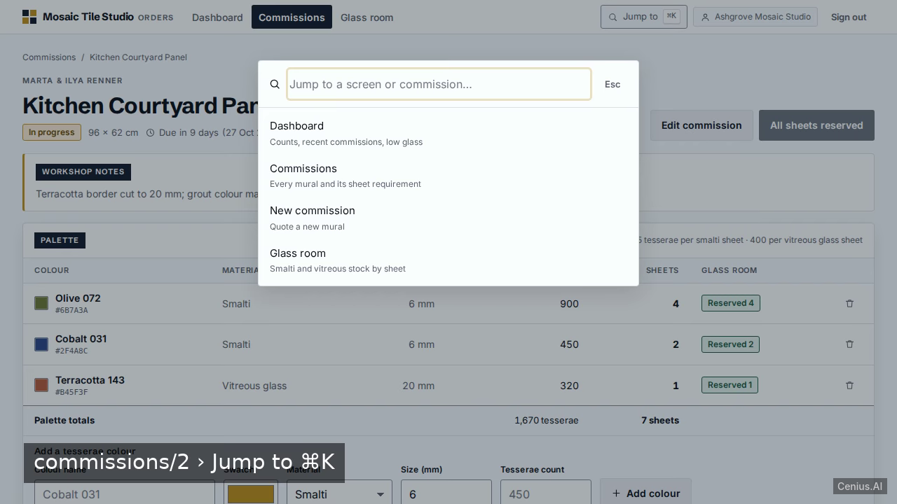

# Mosaic Tile Studio Orders — complete Node.js CRM system example app

Need a self-hosted CRM system? **Mosaic Tile Studio Orders** is the open-source answer: a Node.js project you can clone, run, and own. A server-rendered Express + EJS studio tool for a mosaic workshop: sign in to a demo studio, manage commission murals, break each mural into tesserae colour lines that convert tile counts into sheet counts, keep a sma…. Every Mosaic Tile Studio Orders line of code is here — no stripped demo, no paywalled features. Apache-2.0-licensed; [remix Mosaic Tile Studio Orders on cenius.ai](https://cenius.ai/marketplace/p/mosaic-tile-studio-orders?ref=gh&utm_campaign=mosaic-tile-studio-orders-nodejs) for a bespoke custom version.


[](LICENSE)  [](https://cenius.ai)

[](https://cenius.ai/marketplace/p/mosaic-tile-studio-orders?ref=gh&utm_campaign=mosaic-tile-studio-orders-nodejs)

> **▶ [Open & edit in cenius.ai](https://cenius.ai/marketplace/p/mosaic-tile-studio-orders?ref=gh&utm_campaign=mosaic-tile-studio-orders-nodejs)** — one click to an editable workspace: describe changes in plain English, get an instant preview, one-click deploy and host. Modifications made on the platform come with full rebrand & relicense rights.

_Local clone? See [Quick start](#quick-start) below. cenius.ai is the zero-setup path._

## Demo





▶ **[Full demo walkthrough](https://cenius.ai/marketplace/p/mosaic-tile-studio-orders?ref=gh&utm_campaign=mosaic-tile-studio-orders-nodejs)** — watch it on the project page · [download MP4](.github/media/demo.mp4)

## Screenshots

  

## Features

- Studio sign-in and account
- Studio dashboard
- Commission mural CRUD
- Tesserae colour counts per mural
- Smalti and vitreous stock by sheet
- Reserve sheets from stock
- Grouting and fixing stage tracker
- Seeded demo studio

## Quick start

```bash
./install.sh   # installs dependencies + seeds demo data
```

See [`INSTALL.md`](INSTALL.md) for full setup and usage instructions.

## Architecture

One command (`./install.sh`) covers dependency setup and demo-data seeding. The Node.js codebase (60 files) is self-contained — no external services needed to evaluate it. Top-level layout: `data/`, `public/`, `scripts/`, `src/`, `test/`. Full setup details: [`INSTALL.md`](INSTALL.md).

## Usage guide

Sign in at `/login` with `cenius@cenius.ai` / `cenius` (the card prints the same line). You land on the
dashboard of the seeded studio, Ashgrove Mosaic Studio.

### 1. Read the dashboard

- The four tiles across the top count commissions by status and total the sheets in the glass room.
- **Recent commissions** lists the four newest with client, status chip, sheet requirement and a humanised due
  label (`Due in 9 days`, `Overdue by 14 days`).
- **Stages in progress** names the active workshop stage of every commission that is not yet completed.
- **Low glass** lists every lot at or below its threshold with its sheet count.

### 2. Quote a commission

`Commissions → New commission` (`/commissions/new`). Title is required; dimensions are optional but must be
positive numbers. Saving creates the commission **and** its five workshop stages, and lands you on the detail
page. The new commission appears at the top of `/commissions`.

Editing lives on `/commissions/:id/edit`; the destructive block at the bottom deletes the commission together
with its palette and stage history (it asks first).

### 3. Build the palette

On the commission detail page, `Add a tesserae colour` takes a colour name, a swatch, a material (smalti or
vitreous glass), an optional size in millimetres and the tesserae count. The sheet count is not typed in — it is
computed: `ceil(tesserae ÷ 225)` for smalti, `ceil(tesserae ÷ 400)` for vitreous. A 450-tesserae smalti line
reads `450 tesserae · 2 sheets`. The table footer totals both columns, the dominant colour is listed first, and
each line can be removed.

_Full guide: [`USAGE.md`](USAGE.md)_

## FAQ

### How do I get Mosaic Tile Studio Orders running locally?

Grab the repo and run `./install.sh` — it handles packages and seed data in one go. After that, [`INSTALL.md`](INSTALL.md) walks you through starting the server. No external accounts required.

### How can I customize Mosaic Tile Studio Orders without editing code?

Open it on [cenius.ai](https://cenius.ai/marketplace/p/mosaic-tile-studio-orders?ref=gh&utm_campaign=mosaic-tile-studio-orders-nodejs) and describe the changes you want in plain English — the platform modifies the app and gives you a new, downloadable build.

### Is Mosaic Tile Studio Orders free for commercial use?

Yes. The code is Apache-2.0-licensed — use it, modify it, and ship it commercially. See [LICENSE](LICENSE).

### How do I make Mosaic Tile Studio Orders my own brand?

Absolutely. [Open it on cenius.ai](https://cenius.ai/marketplace/p/mosaic-tile-studio-orders?ref=gh&utm_campaign=mosaic-tile-studio-orders-nodejs) and remix it there — platform modifications come with full rebrand and relicense rights over your derivative, so the result is entirely yours.

### What technologies are in Mosaic Tile Studio Orders's stack?

The app is built with Node.js. What you see in this repo is the full production source, demo data included. Highlights include commission mural CRUD.

## License & rebranding

Released under the [Apache License 2.0](LICENSE) (© 2026 Cenius AI) — free for personal and commercial use. The Cenius name/logo are trademarks (see NOTICE).

**Need a customized version?** [Remix this app on cenius.ai](https://cenius.ai/marketplace/p/mosaic-tile-studio-orders?ref=gh&utm_campaign=mosaic-tile-studio-orders-nodejs) — modifications made on the platform come with **full rebrand & relicense rights** over your derivative.

## Built with cenius.ai

This entire application — code, design, seeded demo data — was generated on **[cenius.ai](https://cenius.ai)** from a plain-English description.

- 🚀 [Build your own app on cenius.ai](https://cenius.ai)
- 🎛️ [Remix Mosaic Tile Studio Orders on the marketplace](https://cenius.ai/marketplace/p/mosaic-tile-studio-orders?ref=gh&utm_campaign=mosaic-tile-studio-orders-nodejs) — open it in a workspace, prompt for changes, and ship your own version.

More open-source apps: [the Cenius-ai catalog](https://github.com/Cenius-ai) · [showcase index](https://github.com/Cenius-ai/showcase)
